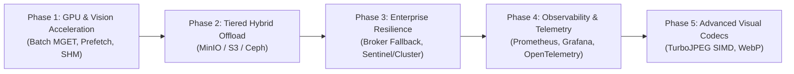

# WKafka Architectural Roadmap & Future Enhancements

This document outlines planned architectural evolution, high-throughput optimizations, and enterprise capabilities scheduled for upcoming releases of WKafka.

---

## 🛠️ Key Technologies and Libraries

- **Apache Kafka & KRaft Protocol**: High-throughput distributed message log.
- **WRedis (`wredis`) & Redis Stack**: Low-latency in-memory data store for volatile Claim-Check routing.
- **MinIO / AWS S3**: Object storage tier for large, immutable binary artifacts.
- **PyTurboJPEG & libjpeg-turbo**: SIMD-accelerated computer vision matrix compression.
- **Prometheus & OpenTelemetry**: Native metrics scraping, latency histograms, and distributed tracing.
- **POSIX Shared Memory (`multiprocessing.shared_memory`)**: Zero-copy inter-process communication on co-located compute nodes.

---

## 🎯 Roadmap Overview

---

## 🚀 Phase 1: High-Throughput GPU & Vision Acceleration

Targeted at deep learning inference pipelines (e.g. YOLO, segmentation models, TensorRT, Triton Inference Server).

### 1.1 Vectorized Batch Retrieval (`MGET`)
- **Problem**: When a consumer processes messages in micro-batches (e.g., 16 or 32 frames) to maximize GPU occupancy, executing individual `GET` queries to Redis incurs $N$ sequential network roundtrips.
- **Solution**: Implement automatic batch offload resolution using Redis `MGET` / pipelines, fetching an entire batch of visual frames in a single TCP roundtrip.

### 1.2 Asynchronous Worker Prefetching
- **Problem**: GPU compute stalls if the next frame must be fetched and decoded synchronously after finishing inference on the current frame.
- **Solution**: Background worker thread pool fetches and decodes upcoming frames ahead of time into a ring buffer in host memory, overlapping I/O latency with GPU computation.

### 1.3 Zero-Copy POSIX Shared Memory (`backend: "shm"`)
- **Problem**: When producer and consumer run on the same physical host or Kubernetes node (sharing an IPC namespace), TCP loopback copies data across kernel space.
- **Solution**: Implement a POSIX Shared Memory offload backend (`/dev/shm`). Frame buffers remain in shared RAM without serialization or socket overhead, reducing latency from ~16 ms to **< 0.5 ms**.

---

## 🌐 Phase 2: Tiered & Hybrid Storage Offload

Expanding the Claim-Check pattern beyond volatile in-memory caching to persistent, multi-gigabyte binary assets.

### 2.1 Multi-Tier Offloading Engine
- **Memory Tier (`backend: "redis"`)**: Ephemeral frames with short TTL (e.g. 5 seconds) and `on_expired="drop"` for strictly real-time video streaming.
- **Object Tier (`backend: "s3"` / `backend: "minio"`)**: Persistent offloading for heavy, immutable files that must never expire (e.g., recorded MP4 video segments, deep learning model weights `.onnx`/`.pt` up to 2 GB, training datasets, and PDF documents).

### 2.2 Intelligent Size-Based Tier Routing
- Transparent routing based on payload threshold:
  - Payloads `< 50 KB`: Transmitted directly over Apache Kafka wire.
  - Payloads `50 KB - 5 MB`: Written to Redis RAM.
  - Payloads `> 5 MB`: Streamed to MinIO/S3 object store.

---

## 🛡️ Phase 3: Enterprise Resilience & High Availability

Hardening payload delivery against network partitions and infrastructure outages.

### 3.1 Graceful Broker Fallback (`fallback_to_broker=True`)
- **Problem**: If the Redis offloading cluster becomes temporarily unreachable or restarts, producers might drop messages or raise unhandled exceptions.
- **Solution**: Configurable fallback policy. If Redis fails health check or exceeds timeout (e.g., 50 ms), the producer transparently downgrades to transmitting the payload directly via the Kafka broker, guaranteeing zero data loss.

### 3.2 Redis Sentinel & Redis Cluster HA Support
- Native configuration integration for `wredis.ha.sentinel` and `wredis.ha.cluster`, enabling automatic failover and distributed keyspace partitioning across Redis nodes.

---

## 📊 Phase 4: Observability, Metrics & Telemetry

Production-grade visibility into Kafka streaming and offload health.

### 4.1 Native Prometheus Metrics Exporter
Exposing an HTTP `/metrics` endpoint with counters and histograms:
- `wkafka_offload_bytes_saved_total`: Cumulative bandwidth and broker disk saved.
- `wkafka_offload_frames_dropped_total`: Stale frames dropped due to TTL expiration.
- `wkafka_offload_latency_seconds`: Latency distributions for backend read/write.
- `wkafka_consumer_lag_frames`: End-to-end frame lag between camera capture and consumer processing.

### 4.2 Turnkey Grafana Dashboard
- Pre-built JSON dashboard templates for Grafana displaying throughput, dropped stale frames, and wire payload savings in real time.

---

## 🖼️ Phase 5: Codec & Compression Advancements

### 5.1 TurboJPEG SIMD Acceleration
- Integration of `PyTurboJPEG` utilizing x86/ARM SIMD instructions, encoding and decoding JPEG matrices 2× to 4× faster than standard libjpeg on CPU.

### 5.2 WebP & AVIF Format Support
- Native support for WebP compression, achieving ~30% smaller byte footprint than JPEG at identical structural similarity (SSIM) visual quality.

---

## 📅 Target Release Milestones

| Target Release | Core Focus | Key Features |
| :--- | :--- | :--- |
| **v1.6.0** | GPU Batching & Prefetching | Redis `MGET` batch retrieval, async prefetch pipeline |
| **v1.7.0** | Tiered Storage | S3 / MinIO persistent offload backend, hybrid routing |
| **v1.8.0** | Resilience & Observability | Graceful broker fallback, Prometheus `/metrics` exporter |
| **v1.9.0** | Zero-Copy & Turbo Codecs | POSIX Shared Memory (`shm`), TurboJPEG acceleration |
| **v2.0.0 (LTS)** | Enterprise Distributed Hub | Unified multi-cluster scaling, complete HA stack |
